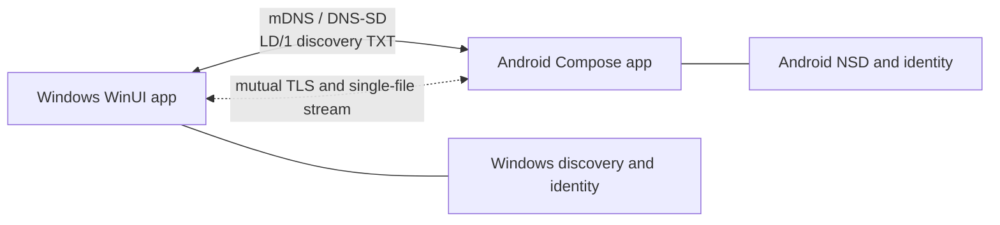

# LocalDrop

LocalDrop is an open-source, local-network file transfer app for Windows and Android. **Version 0.1.0 is in development.** Two-way discovery, transfers in both directions, and a 1 GiB Windows-to-Android transfer have been tested on physical devices. See [installation and setup](INSTALL.md) or the [Türkçe kurulum rehberi](INSTALL.tr.md) for current source-build instructions. No public installer is available yet; check [GitHub Releases](https://github.com/bevyss/LocalDrop/releases) for future signed builds.

## Features

- Automatic mDNS/DNS-SD discovery on the same local network
- Persistent random device IDs, independent of hardware IDs
- Live nearby-device lists, removal on goodbye or timeout, and basic diagnostics
- Experimental single-file transfer with mutual TLS, first-contact code comparison, receiver approval, streaming, and cancellation (physical transfers validated in both directions, including a 1 GiB Windows-to-Android transfer)
- Custom in-app verification and incoming-file prompts, editable device names, and received-file lists with open actions
- English, Turkish, German, Spanish, Chinese, and Japanese interface choices on both platforms
- No account, cloud service, or internet dependency at runtime

## Screenshots

Screenshots of the updated Windows and Android interfaces will be added after physical UI verification. The original wordmark and its square icon are in [branding](branding).

## Supported Platforms

Windows 10/11 and Android 8.0+ (API 26+). Development builds are available; release installers are not yet published.

## How It Works

**Validated with a Windows PC and Android phone:** Device Discovery → Secure Connection → Receiver Accepts → Direct Transfer. Transfers completed in both directions; a 1 GiB Windows-to-Android transfer also completed while both devices stayed awake and connected.



The [LD/1 discovery specification](protocol/docs/LD-1.md) and [single-file transfer extension](protocol/docs/LD-1-transfer.md) are platform independent. The Windows implementation uses .NET 10, WinUI 3, and a DNS-SD library. Android uses Kotlin, Jetpack Compose, and the platform `NsdManager` API.

## Building

For step-by-step setup from a GitHub source download, see [INSTALL.md](INSTALL.md). A source ZIP is not an installer.

### Windows

Install the [.NET 10 SDK](https://dotnet.microsoft.com/download/dotnet/10.0) and the [WinUI development prerequisites](https://learn.microsoft.com/windows/apps/get-started/start-here) (Visual Studio WinUI workload and Windows Developer Mode for the packaged app). From the repo root:

```powershell
dotnet build apps/windows/LocalDrop.Windows/LocalDrop.Windows.csproj -p:Platform=x64
dotnet test apps/windows/LocalDrop.Core.Tests/LocalDrop.Core.Tests.csproj
dotnet run --project apps/windows/LocalDrop.Windows/LocalDrop.Windows.csproj -p:Platform=x64
```

On first run, allow LocalDrop on **private** networks if Windows Firewall prompts. Normal use does not require administrator privileges.

### Android

Install JDK 17 and Android SDK Platform 36. Set `ANDROID_HOME` to the SDK path. From `apps/android`:

```powershell
./gradlew.bat :app:assembleDebug :app:testDebugUnitTest
./gradlew.bat :app:installDebug
```

Alternatively, open `apps/android` in Android Studio and run the `app` configuration on a phone. Keep LocalDrop visible during discovery and transfer. Android may require Wi-Fi multicast support from the router.

## Device validation

Run both apps on the same Wi-Fi/LAN and check that each shows the other's name. Keep both in the foreground. A guest network, client isolation, VPN, or firewall that blocks mDNS (UDP 5353) can prevent discovery. See [development guide](docs/DEVELOPMENT.md) for a repeatable checklist. On 2026-09-30, the project owner confirmed two-way discovery, transfer in both directions, cancellation, duplicate-name handling, and a controlled phone Wi-Fi interruption. The owner also confirmed that the redesigned Windows title bar and Android received-file view work. The latest language and selection changes have not had a visual review.

## Security

DNS-SD names and TXT data are untrusted and can be spoofed. Phase 2 transfer code uses mutual TLS, a first-contact comparison code, local certificate pinning, and explicit receiver approval. A deliberately incorrect checksum was rejected on Android without publishing a file. **Do not use this development build for sensitive files yet.** See [security architecture](docs/SECURITY_ARCHITECTURE.md) and [reporting policy](SECURITY.md).

## Roadmap

See [ROADMAP.md](ROADMAP.md) and the [release security checklist](docs/RELEASE_SECURITY.md). The latest language and selection visuals need a UI check before the next release.

## Contributing

See [CONTRIBUTING.md](CONTRIBUTING.md).

## License

MIT. See [LICENSE](LICENSE).
